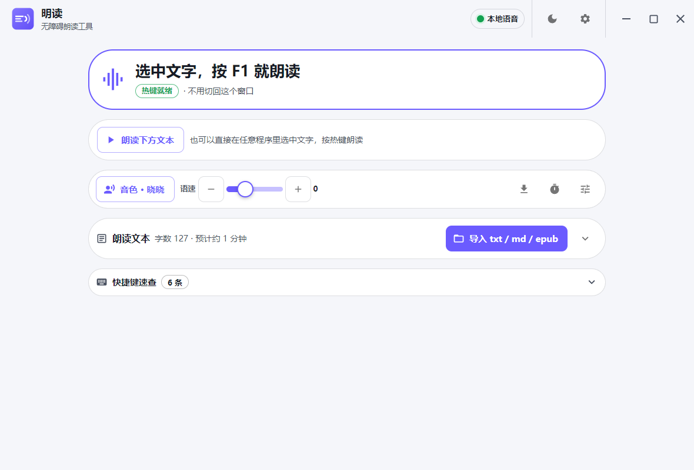
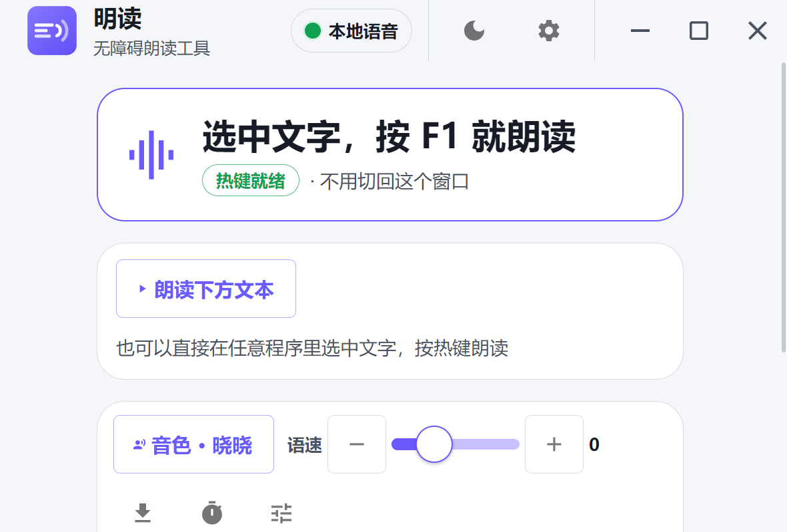

# 明读

### 看网页、看文档，眼睛看累了？选中一段，按 F1 就念给你听。

不用复制粘贴，不用切到别的窗口，不用联网。

<p align="center">
  
</p>

它做的事只有一件：**把你选中的字，读出来。**

| 你想干什么 | 怎么做 |
|---|---|
| **只想听这一段** | 选中文字 → 按 **F1** → 立刻出声 |
| **想听整篇文档** | 把 txt / md 拖进窗口 → 点「朗读下方文本」 |
| **念得太快 / 太慢** | 主界面上 **−／+** 随时调，不用停下 |
| **想换个声音** | 点「音色」，晓晓（女声）/ 云希（男声）随时切 |
| **不想听了** | 按 **Esc**，或点停止 |
| **字太小看不清** | 按住 **Alt** 滚滚轮放大，画面跟着鼠标走 |

读完会**自动还原你的剪贴板**——你刚才复制的东西不会丢。

---

## 这是给谁做的

- 长时间看屏幕、眼睛容易酸的人
- 低视力、弱视、术后视力不佳的朋友
- 需要「边听边做别的事」的人：一边听文档，一边记笔记
- 以及帮长辈装电脑的家人

它是给**还看得见、但看得很吃力**的人做的，不是给全盲朋友的 ——
完全看不见的话，[NVDA](https://www.nvaccess.org/) 更合适。

不需要学任何复杂操作，就**选中**和**按一下 F1** 两个动作。

---

## 为什么它快

选中文字到听见声音，**大约 0.15 秒**。这是本地语音，不经过网络。

在线语音做不到这么快：每合成一句都要重新握手，光这一步就要 0.9 秒。所以本项目的默认路径是**本机离线语音**，「在线」只在本地完全不可用时才作为兜底，并且界面上会明确标出来。

第一次安装后它会在后台把语音装到本机（约 140MB，从官方渠道下载，只需一次）。

---

## 六个热键

| 操作 | 效果 |
|---|---|
| **F1** | 朗读选中的文字 |
| **Esc** | 停止朗读 |
| **Alt + 滚轮** | 放大 / 缩小画面 |
| **Ctrl + Alt + =** | 放大一档 |
| **Ctrl + Alt + −** | 缩小一档 |
| **Ctrl + Alt + 0** | 退出放大 |

热键可以在设置里换。如果 F1 被别的程序占着（有些管理软件会抢），它会自动改用底层监听，照样能按，并且**用语音告诉你**发生了什么，不会静默失效。

---

## 它不会做的事

- **不联网也能用**：本地语音不依赖网络；只有你主动用在线音色时才联网
- **不上传你的文字**：本地合成的内容不出本机
- **不动你的剪贴板**：读完还原
- **不需要账号**：没有登录、没有会员
- **不弹广告**：没有

---

## 系统要求

- Windows 10 / 11 x64
- 安装包与免安装 zip 都在 [Releases](https://github.com/zjh1934/mingread/releases/latest)：`MingRead-<版本>-setup.exe`（安装）或 `MingRead-<版本>-win-x64.zip`（免安装）

## 自己编译

```bash
cd app
npm install
npm run dev      # 开发
node node_modules/electron-builder/out/cli/cli.js --win nsis zip   # 打包
```

## 可访问性

- 字号 1.0–2.0× 全局跟随，2.0× 下不破版
- 浅色 / 深色 / 高对比度三套主题
- 所有可点元素 ≥ 44px，键盘全程可达
- 状态变化有语音播报（可关）

<p align="center">
  
  
</p>

<p align="center">
  <sub>左：深色主题　右：2.0× 字号档（同一界面等比放大，无横向溢出）</sub>
</p>

## 遇到问题怎么办

程序会在 `%APPDATA%\MingRead\` 下留两份记录，反馈问题时附上即可定位：

| 文件 | 内容 |
|---|---|
| `boot.log` | 启动到哪一步：模块加载 → 系统就绪 → 窗口显示（含耗时）。如果双击没反应，看这个文件有没有内容，就能判断是「没启动」还是「启动了但没出窗口」 |
| `diagnostics.log` | 关键选择：版本、放大用的是系统接口还是兜底方案、DLL 来源 |

两份都不记录你朗读的内容、不记录按键、不联网。

## 许可证

[MIT](LICENSE)
