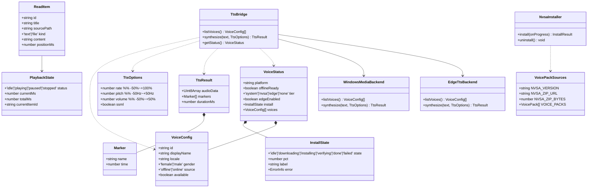
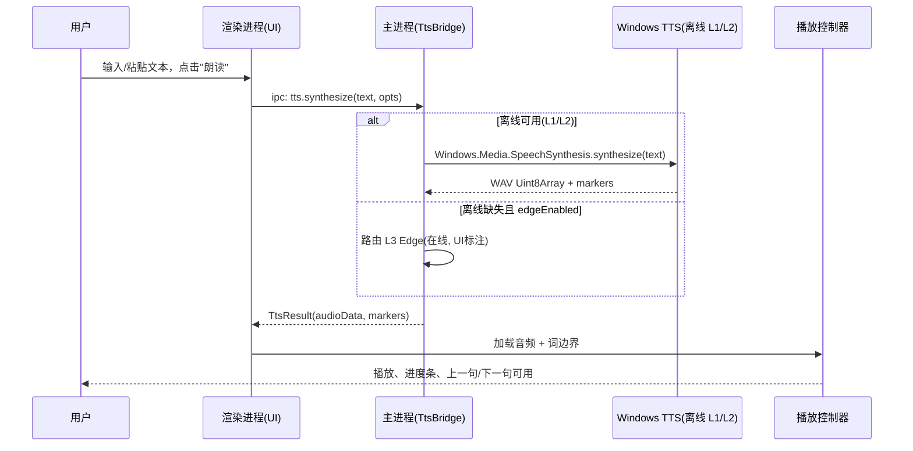
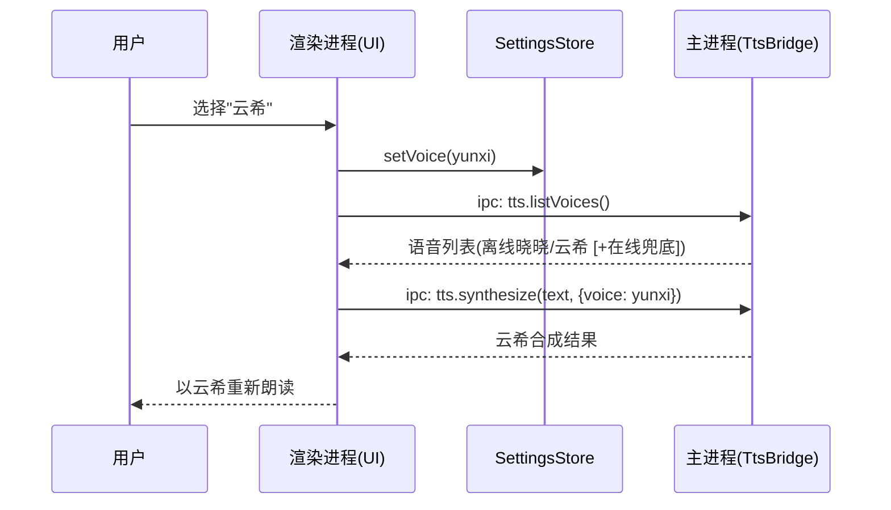

# 架构设计 · 朗读女开源重构版

> 角色：架构师（高见远）｜阶段：阶段 3-Pivot 修订（2026-10-23 晚）｜输入：PRD / 原版功能清单 / 开源文档骨架建议 / `任务书/交接-工程师寇豆码.md`（v2 pivot 版）
> 核心约束（pivot 后）：TTS = **三层引擎链**——**L1** Win11 系统自然语音（零配置）/ **L2** NVSA 自动装配（主离线后端，覆盖 Win7/8.1/10/11）/ **L3** Edge 在线兜底（默认开、可关、UI 标注「在线」）；**离线优先**；语音资源**全自动装配、用户零操作（最多一次 UAC）**；**不手搓引擎**（弃用 onnxruntime-node 手搓推理）；MIT 开源；3–5 次自检。

---

## 0. 文档约定与依据

- 本设计依据 `设计/PRD.md`、`设计/原版朗读女功能清单.md`、`设计/开源文档骨架建议.md`。
- TTS 定案以 `任务书/交接-工程师寇豆码.md`（v2 pivot 版，2026-10-23 19:40）为**权威规格**（含全部 URL 与安装步骤）；本文为其架构侧落文档。
- 历史沿革：§10 完整保留阶段 2 决策记录（§10.1），并新增 §10.2 记录本次 pivot（阶段 3）决策；凡与 §10.2 冲突的旧表述以 §10.2 为准。

---

## 1. 技术选型与论证

### 1.1 主推：Electron + React + MUI + Tailwind CSS（桌面端）

| 维度    | 选型                       | 理由                                                                                    |
| ----- | ------------------------ | ------------------------------------------------------------------------------------- |
| 桌面框架  | **Electron**（主进程 + 渲染进程） | 目标为 Windows 桌面软件，Electron 分发体验最佳、安装包 + 源码双下载对齐参考项目；可调用系统级 API（剪贴板、托盘、全局热键、系统 TTS 桥接）。 |
| UI 框架 | **React + Vite**         | 组件化、生态成熟、热更新快；Vite 构建 Electron 主/渲染流程顺滑。                                              |
| 组件库   | **MUI（Material UI）**     | 开箱即用的现代组件、深浅色主题（ThemeProvider）、响应式；对标"原版 10 年前老界面"的现代化重构。                             |
| 样式    | **Tailwind CSS**         | 原子化样式，与 MUI 互补做布局与细节打磨，避免样式膨胀。                                                        |
| 状态    | **Zustand**              | 轻量全局状态（播放状态、音色配置、列表），比 Redux 更贴合本项目规模。                          |
| 打包    | **electron-builder**     | 生成 Windows 安装包（`.exe`/`.msi`）+ 自动更新可选，对齐"方便下载"。                                       |

### 1.2 TTS 引擎：三层引擎链（离线优先 + Edge 兜底，覆盖 Win7/8.1/10/11）

> **Pivot 修订（2026-10-23 晚，用户要求）**：弃用「onnxruntime-node 手搓便携引擎 + 用户手动放置语音包」双后端方案，改为**三层引擎链**。原则：**「别让我动手」**（资源全自动、用户零操作，最多一次 UAC）、**「能扒的就直接搬」**（复用社区成熟开源方案，禁手搓引擎）、**「调用 Edge 的接口作为一个备用方案，优先使用语音包」**（离线优先 + Edge 在线兜底）。

| 层 | 覆盖平台 | 机制 | 用户操作 |
|---|---|---|---|
| **L1 系统自然语音** | Win11 22H2+ | 系统已装晓晓/云希，`@echogarden/windows-media-tts` 零配置 | 无 |
| **L2 NVSA 自动装配（主离线后端）** | Win7 / 8.1 / 10 / 11（含无系统语音的 Win11） | 应用自动下载 NaturalVoiceSAPIAdapter（MIT）+ 晓晓/云希 MSIX（NVDA 中文站直链），解压 + 一次管理员 `regsvr32` 注册 + 按仓库文档写每用户 HKCU 配置；语音成为**标准 SAPI5 语音**，经**同一 `@echogarden/windows-media-tts` 通道**枚举调用，桥接零改动 | 一次 UAC 确认 |
| **L3 Edge 在线兜底** | 任意（需网络） | `node-edge-tts`（许可证须宽松，避开 GPL/AGPL），晓晓/云希在线神经语音 | 无（默认开启，设置可关，UI 标注「在线」） |

- **路由规则**：`synthesize()` 优先 L1/L2 离线；离线不可用且 `edgeEnabled` → L3；仍不行 → 友好错误（不崩溃、不静默）。
- **桥接封装**：`TtsBridge` 抽象三层后端，对上层暴露统一 `listVoices()/synthesize()`；语音项带 `source:'offline'|'online'`。**此为「扒开源、不手搓」的核心复用成果**（NaturalVoiceSAPIAdapter + `@echogarden/windows-media-tts` + Edge 开源库）。
- **默认音色**：首次启动默认选中**晓晓**；**云希**为一键可切换的第二默认。

### 1.3 备选方案对比与取舍

| 方案                                                             | 说明                                             | 离线                 | 合规/风险                                     | 结论                           |
| -------------------------------------------------------------- | ---------------------------------------------- | ------------------ | ----------------------------------------- | ---------------------------- |
| **C'. NaturalVoiceSAPIAdapter + 晓晓/云希 MSIX 自动装配（主离线后端）** | MIT 适配器把商店语音注册为标准 SAPI5 语音，应用全自动装配；覆盖 Win7/8.1/10/11 | ✅ 离线               | ✅ MIT 适配器；MSIX 为微软商店原始公开包（NVDA 中文站托管、未修改），运行时下载、不随包分发 | **采用（主离线后端）**                       |
| A'. Win11 22H2+ 系统离线自然语音（L1 零配置层）                          | `@echogarden/windows-media-tts` 桥接系统已装晓晓/云希，零配置              | ✅ 完全离线             | ✅ 合规（语音由微软 OS 交付）                         | **采用（L1 优化层）**                     |
| E'. 在线 Edge TTS 兜底                                            | `node-edge-tts` 连微软在线端点                         | ❌ 需联网              | ⚠️ 许可证须宽松（MIT/BSD/Apache-2.0，禁 GPL/AGPL）；UI 标注「在线」、可关闭 | **采用（可关闭的在线兜底，默认开）**         |
| ~~B. 便携式离线引擎（onnxruntime-node + 微软 ONNX 模型）~~                | ~~语音模型随应用分发，本地 ONNX 推理~~                        | ✅ 完全离线             | ❌ 违背「不手搓引擎」+「别让我动手」原则；再分发许可存疑    | **弃用删除**（pivot，见 §10.2）           |
| ~~手动放置语音包流程（`resources/voice-models/`）~~                        | ~~引导用户手动下载/放置模型~~                              | ✅ 离线               | ❌ 违背「别让我动手」原则                          | **弃用删除**（pivot，见 §10.2）           |
| D. Vite + React 网页版 + 本地离线 TTS                                 | 纯 Web，离线 TTS 受限                                | ⚠️ 浏览器无系统 TTS 直接访问 | 跨平台但 TTS 桥接无原生优势                          | 备选：仅当离线语音包体积/分发受限时再评估（本期不需要） |

> 取舍结论：**三层引擎链**——L1 系统语音（Win11 零配置）+ L2 NVSA 自动装配（主离线后端，覆盖 Win7/8.1/10/11，用户零操作、最多一次 UAC）+ L3 Edge 在线兜底（默认开、可关）——在「离线优先、全平台、合规、可复用开源桥接」上全面占优；onnx 手搓引擎与手动放置流程已弃用（违反用户 pivot 原则）。

### 1.4 依赖与体积/分发

- 安装包主要由 Electron 运行时（~80–100MB 业界常规）+ 应用代码构成；**语音资源不进安装包**——首次装配时由应用自动下载（约 **23MB NVSA 资产 + 两个 MSIX**，仅一次，之后完全离线）。
- 这反而让安装包保持小巧、合规（不捆绑微软专有二进制），且离线合成 100% 本地、无密钥、无云端。

---

## 2. TTS 集成方案调研结论（核心 · pivot 修订）

> 本章为架构师阶段必须先行产出的"调研结论"，含可行路径、依赖、语音包来源与分发方式、跨平台取舍。外部事实均于 **2026-10-23 实测核实**。

### 2.1 候选路径（pivot 后）

- **路径 A0（主离线路径 · 覆盖 Win7/8.1/10/11）— NaturalVoiceSAPIAdapter 自动装配**
  - [NaturalVoiceSAPIAdapter](https://github.com/gexgd0419/NaturalVoiceSAPIAdapter)（MIT）把晓晓/云希 MSIX 注册为**标准 SAPI5 语音**，随后经 `@echogarden/windows-media-tts` **同一桥接通道**枚举调用——桥接零改动。
  - 安装 = 解压 zip + `regsvr32` 注册 x64 DLL（**一次管理员**，README 明文的脚本化路径）+ MSIX 当 ZIP 解压到 ASCII 目录 + 写 HKCU 每用户配置（**免管理员**）。
  - **全自动**：下载 → 解压 → 注册 → 配置 → 验证，用户零操作，最多一次 UAC（用户原则「别让我动手」+「能扒的就直接搬」）。
  - 工作目录 `app.getPath('userData')/voice-pack/`（位于 %APPDATA%，默认 ASCII 路径，满足 NVSA 路径要求）。
- **路径 A（L1 · Win11 22H2+ 优化）— 系统级离线神经语音 + WinRT 桥接**
  - Windows 11 22H2+ 内置"自然语音（Natural Voices）"：晓晓、云希等，**下载安装后断网即可合成**，无需云端。
  - 桥接：`@echogarden/windows-media-tts` 直接绑定该 API，返回 WAV，支持 SSML 与 `timedMetadataTracks`（词/句时间戳）。
  - **定位**：Win11 22H2+ 且系统已装语音时优先使用（零配置、音质最佳）；系统缺失时回退到路径 A0 自动装配。
- **路径 E（L3 · Edge 在线兜底）**
  - `node-edge-tts`（选型中，许可证须宽松：MIT/BSD/Apache-2.0，**严禁 GPL/AGPL**；备选 `edge-tts-ts`；若均不可用，按公开 WS 协议最小实现并在文件头注明参考来源——最后手段）。
  - 默认开、可关、UI 标注「在线」；网络失败返回 `EDGE_NETWORK` 类可读错误，不崩溃、不静默改走别的音。
- **已弃用路径（仅记录备查）**
  - ~~onnxruntime-node 手搓便携推理引擎~~（`src/main/onnxTtsEngine.js` + `src/main/backends/onnxBackend.js`）——违背「不手搓引擎」原则，**删除**。
  - ~~引导用户手动放置微软离线模型包~~（`resources/voice-models/` 流程）——违背「别让我动手」原则，**删除**。

### 2.2 关键事实（2026-10-23 实测核实）

1. **NaturalVoiceSAPIAdapter v0.2.10**（2026-10-14 发布，MIT）：资产 `NaturalVoiceSAPIAdapter_v0.2.10_x86_x64.zip`（**22,999,239 字节**，GitHub Releases；同页另有 ARM64 资产，首版不用）。支持 XP~Win11，本地 Narrator 语音需 Win7+ → **正好覆盖 Win7/8.1/10/11**。
2. **安装路径（README 原文要点）**：解压 zip → `Installer.exe`（需管理员）→ Install；**或 `regsvr32` 手动注册 x64 DLL**（README 明文的脚本化路径，优先用它，免 GUI 交互）。
3. **语音加载通用方式**：把 MSIX 当 ZIP 解压到 ASCII 路径的子文件夹，父文件夹写入 `HKCU\Software\NaturalVoiceSAPIAdapter\Enumerator` 的 `NarratorVoicePath`（REG_SZ）。**每用户配置，不需要管理员。**
4. **保持离线的注册表开关**（上述 HKCU 下，DWORD=1）：`NoEdgeVoices`、`NoAzureVoices`——NVSA 默认启用 Edge/Azure 在线语音，必须显式关闭，避免污染 SAPI 列表、避免走 NVSA 自己的网络栈。
5. **语音 MSIX「最后可用版本」**（商店新版已被微软更换解密密钥而失效）：
   - 晓晓 1.0.9.0：`https://dl.nvdacn.com/NVDA-Addons/TTS/NaturalVoices/MicrosoftWindows.Voice.zh-CN.Xiaoxiao.1_1.0.9.0_x64__cw5n1h2txyewy.Msix`
   - 云希 1.0.4.0：`https://dl.nvdacn.com/NVDA-Addons/TTS/NaturalVoices/MicrosoftWindows.Voice.zh-CN.Yunxi.1_1.0.4.0_x64__cw5n1h2txyewy.Msix`
   - 均为 NVDA 中文站托管的**微软商店原始 MSIX（未修改）**；已实测可达（302 → SharePoint，跟随重定向即可）。
6. **`@echogarden/windows-media-tts` ^0.1.2**（MIT，N-API 预编译 x64+arm64）：保留不动；**L1（Win11 系统语音）与 L2（NVSA 注册后的 SAPI5 语音）共用同一桥接通道，零改动**。
7. Win11 22H2+ 系统已装晓晓/云希时走 L1 零配置；Win7/Win10 及缺失系统语音的 Win11 走 L2 自动装配。

### 2.3 桥接方案（落地）

- 在 Electron **主进程**内封装单例 `TtsBridge`：
  - `listVoices()` → 枚举 `getVoiceList()`，筛出 `zh-CN` 且名称含 `Xiaoxiao`/`Yunxi` 的语音；每项带 `source:'offline'|'online'`；
  - `synthesize(text, {voice, rate, pitch, volume})` → 路由到 L1/L2（WAV `Uint8Array`）或 L3（mp3，应用已有 mp3 通路/lamejs）；
  - 支持 SSML（`enableSsml`）与 `timedMetadataTracks`（词/句边界）用于进度跳转与字幕；Edge 后端尽量获取句子边界时间戳返回 markers；
  - 新增 `getStatus()`（结构见 §3.3）与事件 `voice:progress` / `voice:statusChanged`；
  - 通过 `contextBridge` 暴露为渲染进程可调用 API。
- 参考开源：`kuoleroy/desktop-tts` 已验证"Windows 11 自带 Microsoft Xiaoxiao/Yunxi (Natural) 离线神经语音，音质接近在线"可作为旁证；Edge 后端设计借鉴 `JJosephph/ms-edge-tts-gui`（GPL-3.0，**只借鉴设计、不拷代码**）。

### 2.4 语音包来源与分发方式（**合规要点，必须点明**）

- **三层来源**：
  1. **L1 系统语音**：Win11 OS 交付，**不捆绑**微软二进制。
  2. **L2 NVSA 自动装配**：适配器（MIT，GitHub Releases 运行时下载）+ 晓晓/云希 MSIX（NVDA 中文站托管的微软商店原始 MSIX，未修改，pin 最后可用版本）。**不随安装包分发微软二进制；运行时下载公开资源。**
  3. **L3 Edge**：在线服务，无二进制分发。
- **「最后可用版本」背景**：微软已更换商店语音包解密密钥，商店新版 MSIX 无法被 NVSA 解密使用；故 pin 晓晓 **1.0.9.0** / 云希 **1.0.4.0**，并在 `voicePackSources.js` 集中管理全部 URL / 字节数 / 备用镜像（NVDA 主站 `nvdacn.com/index.php/tts.html` 等），密钥再次失效时可快速切换。
- **分发合规结论（pivot 定案）**：
  - 本项目**非商用**；所使用的均为公开资源 + 宽松许可证（适配器 MIT；语音包为微软商店原始公开包）。
  - 安装包**只含自研代码 + 自构建安装包**；语音资源一律**运行时下载**，不随安装包分发任何微软二进制。
  - 全部第三方组件记入 `THIRD-PARTY-NOTICES.md`（名称/版本/许可证/来源链接）。
  - 主进程除「语音装配下载」与「Edge 兜底」外**零网络调用**。
- **默认音色**：应用默认选中**晓晓**、**云希**一键切换；离线路径下合成 100% 本地，无云、无密钥。

### 2.5 离线优先策略（pivot 更新）

- **离线优先**：所有合成默认走 L1/L2 离线；离线不可用且 `edgeEnabled`（默认 true）→ L3 Edge 兜底；仍不行 → 友好错误（不崩溃、不静默）。
- **Edge 兜底默认开**（用户明确要备用方案），设置可关；UI 对在线音色标注「在线」。
- 检测不到离线语音时**自动装配**（而非提示用户手动安装）；装配失败才提示，并说明可用 Edge 兜底。

### 2.6 跨平台取舍

- 目标平台：**Windows 7 / 8.1 / 10 / 11 全部支持**（NVSA 覆盖 Win7+；L1 零配置仅 Win11 22H2+，作为优化层，其存在与否不影响全平台可用）。
- **首版仅 x64**（NVSA 资产与 Electron 均 x64；ARM64 资产存在但首版不用）。
- Electron 工程本身跨平台，但 TTS 桥接仅 Windows 可用；**非 Windows 平台本期不启用朗读**（UI 给出"当前平台不支持本地 TTS"提示），不引入除 Edge 外的其他在线回退。
- 备选 D（网页版）本期不需要——Electron 已最佳覆盖桌面分发。

### 2.7 调研结论一句话

> **采用三层引擎链：L1 Win11 系统自然语音零配置；L2 以 NaturalVoiceSAPIAdapter（MIT，v0.2.10 pin）自动装配晓晓/云希 MSIX（pin 最后可用版本 1.0.9.0 / 1.0.4.0）为标准 SAPI5 语音，覆盖 Win7/8.1/10/11，用户零操作、最多一次 UAC，经同一 `@echogarden/windows-media-tts` 通道调用；L3 Edge 在线兜底默认开、可关。语音资源运行时下载公开资源、不随安装包分发；不手搓引擎。**

---

## 3. 系统架构

### 3.1 整体架构（主进程 / 渲染进程 / TTS 桥接）

```mermaid
flowchart TB
    subgraph Renderer["渲染进程 (React + MUI + Tailwind)"]
        UI[主界面: 编辑器/列表/控制条/设置]
        Theme[主题与响应式]
        Hotkey[全局热键与托盘浮标]
    end
    subgraph Main["主进程 (Electron Main)"]
        App[应用生命周期/窗口管理]
        Tray[系统托盘]
        Clip[剪贴板监视]
        Bridge[TtsBridge 单例<br/>三层引擎链路由]
        subgraph Backends["TTS 后端"]
            WM[windowsMediaBackend<br/>L1/L2: @echogarden/windows-media-tts]
            Edge[edgeTtsBackend<br/>L3: Edge 在线兜底]
        end
        VoiceSetup[VoiceSetup 自动装配编排]
        NvsaInstaller[NvsaInstaller 装配器]
        VoicePackSources[voicePackSources 资源 pin]
        Export[音频导出 (WAV/MP3)]
    end
    subgraph OS["Windows 系统层（Win7/8.1/10/11）"]
        TTS[离线神经语音 晓晓/云希<br/>系统语音(Win11 L1) / NVSA 注册 SAPI5(L2)]
        Audio[音频输出/文件]
    end
    subgraph Cloud["微软在线服务（仅 L3 兜底）"]
        EdgeTTS[Edge TTS 端点]
    end

    UI -- IPC(contextBridge) --> App
    App --> Bridge
    Bridge --> WM
    Bridge --> Edge
    WM --> TTS
    Edge --> EdgeTTS
    TTS --> Audio
    Clip --> UI
    Tray --> App
    VoiceSetup --> NvsaInstaller
    NvsaInstaller --> VoicePackSources
    VoiceSetup --> TTS
    Export --> Audio
```

### 3.2 模块划分

| 模块                   | 进程   | 职责                                         |
| -------------------- | ---- | ------------------------------------------ |
| `TtsBridge`          | 主进程  | 三层引擎链路由：枚举语音、合成（文本/SSML）、词边界标记、MP3/WAV 导出、`getStatus()`、进度/状态事件 |
| `WindowsMediaBackend` | 主进程  | L1/L2 离线后端：封装 `@echogarden/windows-media-tts`（系统语音 + NVSA 注册的 SAPI5 语音同一通道） |
| `EdgeTtsBackend`     | 主进程  | L3 在线兜底后端：`listVoices()/synthesize()`（mp3 + 句子边界 markers） |
| `VoiceSetup`         | 主进程  | 自动装配编排：探测平台 + 枚举语音 → 缺失则触发自动装配（推进度事件）→ 验证；失败给出错误 + Edge 兜底提示 |
| `NvsaInstaller`      | 主进程  | NVSA 自动装配器：下载（进度/校验）→ 解压 → `regsvr32` 提权注册 → HKCU 配置 → 重新枚举验证；失败分类 + 重试 + `uninstall()` |
| `VoicePackSources`   | 主进程  | 集中 pin 全部外部资源（NVSA 版本/资产 URL/字节数、晓晓/云希 MSIX URL、备用镜像、许可证） |
| `ClipboardMonitor`   | 主进程  | 监视剪贴板，复制即入队/一键朗读                           |
| `PlaybackController` | 渲染进程 | 播放/暂停/停止/进度/上一句下一句（基于词边界）                  |
| `LibraryManager`     | 渲染+主 | 朗读列表/章节管理、顺序/循环、进度记忆                       |
| `HotkeyTray`         | 主进程  | 全局热键、系统托盘浮标                                |
| `SettingsStore`      | 渲染进程 | 音色、语速/语调/音量、主题、**Edge 兜底开关（默认开）**             |
| `Exporter`           | 主进程  | 当前/批量文本 → WAV/MP3；字幕 SRT/LRC               |

### 3.3 数据结构与接口（Mermaid 类图）



### 3.4 关键调用流程（时序图）

**流程 1：点击朗读 → TTS 请求 → 音频播放**



**流程 2：音色切换（晓晓 ↔ 云希）**



**流程 3：首次运行 → 离线语音自动装配（用户零操作，最多一次 UAC）**

```mermaid
sequenceDiagram
    participant A as 应用启动
    participant M as VoiceSetup
    participant I as NvsaInstaller
    participant T as Windows TTS(SAPI5/WinRT)
    participant U as 用户

    A->>M: ensureOfflineVoices()
    M->>T: 枚举语音(晓晓/云希)
    alt 已有离线语音(系统 L1 或已装 NVSA L2)
        T-->>M: 命中 → offlineReady=true, tier=system|nvsa
        M-->>A: 设晓晓默认，进入主界面
    else 缺失 → 自动装配(用户零操作)
        M-->>U: 展示装配引导(下载/安装/验证进度)
        M->>I: install(onProgress)
        I->>I: 下载 NVSA zip + 晓晓/云希 MSIX(进度+大小校验, 跟随重定向)
        I->>I: 解压 zip; MSIX 当 ZIP 解压到 voice-pack/voices/<ASCII 目录>
        I->>U: 一次 UAC 授权请求(仅 regsvr32 注册 x64 DLL)
        U-->>I: 确认
        I->>T: regsvr32 注册 x64 引擎 DLL
        I->>I: 写 HKCU 配置(NarratorVoicePath / NoEdgeVoices=1 / NoAzureVoices=1)
        I->>T: 重新枚举验证
        T-->>I: 出现 zh-CN Xiaoxiao / Yunxi
        I-->>M: done → offlineReady=true, tier=nvsa
        M-->>A: 设晓晓默认，进入主界面
    else 装配失败
        I-->>M: 失败(VP_* 错误码 + 中文可读信息, 可重试)
        M-->>U: 提示重试 / 使用 Edge 兜底(默认开, 标注在线)
    end
```

---

## 4. 文件结构（src/ 全部相对路径与职责）

```
朗读女/
├─ package.json                 # 依赖与脚本(electron/vite/build)
├─ vite.config.js               # Vite 多入口(主/渲染)
├─ electron-builder.yml         # Windows 安装包配置
├─ tailwind.config.js           # Tailwind 配置
├─ postcss.config.js
├─ index.html                   # 渲染入口
├─ src/
│  ├─ main/
│  │  ├─ index.js               # 主进程入口: 窗口/生命周期
│  │  ├─ ttsBridge.js           # TtsBridge 单例(三层引擎链路由+getStatus+事件)
│  │  ├─ voiceSetup.js          # 自动装配编排(探测→装配→验证→Edge 兜底提示)
│  │  ├─ voicePackSources.js    # 集中 pin 外部资源(NVSA/MSIX URL/字节数/许可证/镜像)
│  │  ├─ nvsaInstaller.js       # NVSA 自动装配器(下载/解压/regsvr32/HKCU/验证/卸载)
│  │  ├─ clipboardMonitor.js    # 剪贴板监视
│  │  ├─ hotkeyTray.js          # 全局热键 + 系统托盘
│  │  ├─ exporter.js            # WAV/MP3 导出(lamejs) + SRT/LRC
│  │  ├─ ipc.js                 # ipcMain 注册(tts.* 沿用 + voice.* 新通道)
│  │  └─ backends/
│  │     ├─ windowsMediaBackend.js  # L1/L2 离线后端(@echogarden/windows-media-tts)
│  │     └─ edgeTtsBackend.js       # L3 Edge 在线兜底后端
│  ├─ preload/
│  │  └─ index.js               # contextBridge 暴露安全 API(window.api.tts.* + window.api.voice.*)
│  ├─ renderer/
│  │  ├─ main.jsx               # React 入口
│  │  ├─ App.jsx                # 根组件 + 路由/布局
│  │  ├─ theme.js               # MUI 主题(浅/深)
│  │  ├─ store/
│  │  │  ├─ settingsStore.js    # Zustand: 音色/调速/主题/Edge 兜底开关(默认开)
│  │  │  └─ libraryStore.js     # Zustand: 朗读列表/进度
│  │  ├─ components/
│  │  │  ├─ Editor.jsx          # 文本输入(F-01)
│  │  │  ├─ Controls.jsx        # 播放控制(F-03)
│  │  │  ├─ VoicePicker.jsx     # 音色选择 晓晓/云希(F-04, 在线音色标注)
│  │  │  ├─ TuningPanel.jsx     # 语速/语调/音量(F-05/06/07)
│  │  │  ├─ LibraryPanel.jsx    # 朗读列表/章节(F-08)
│  │  │  ├─ TimerPanel.jsx      # 定时关闭(F-11)
│  │  │  └─ SettingsDialog.jsx  # 设置(主题/热键/Edge 兜底开关)
│  │  └─ hooks/
│  │     ├─ useTts.js           # 调用 preload TTS API
│  │     └─ usePlayback.js      # 播放控制 + 词边界跳转
│  ├─ shared/
│  │  ├─ constants.js           # 默认音色/范围常量
│  │  └─ types.js               # 共享类型(VoiceConfig/TtsOptions/VoiceStatus/...)
│  └─ scripts/                  # 见 scripts/ (自检 + TTS 探针)
├─ scripts/                     # Python 自检脚本(对齐开源骨架)
│  ├─ selfcheck_env.py
│  ├─ selfcheck_voices.py
│  ├─ selfcheck_tts.py
│  ├─ selfcheck_build.py
│  ├─ selfcheck_ui.py          # (可选)
│  ├─ selfcheck_all.py
│  └─ _tts_probe.mjs           # Node 探针: 复用 @echogarden/windows-media-tts 供 Python 调用
├─ resources/                  # (不放语音模型; 仅图标等静态资源)
├─ THIRD-PARTY-NOTICES.md       # 第三方组件清单(名称/版本/许可证/来源)
├─ LICENSE                      # MIT
├─ README.md                    # 中文 + 双下载入口 + badge
└─ PRD.md / 设计/ (已有)
```

> **pivot 增删说明**：
> - **新增**：`src/main/voicePackSources.js`、`src/main/nvsaInstaller.js`、`src/main/backends/edgeTtsBackend.js`、`THIRD-PARTY-NOTICES.md`。
> - **删除（git rm）**：`src/main/onnxTtsEngine.js`、`src/main/backends/onnxBackend.js`、`resources/voice-models/`（整个目录，手动放置流程废止）。

---

## 5. 依赖包清单

| 类别 | 包 | 用途 |
|---|---|---|
| 桌面 | `electron`, `electron-builder` | 桌面壳 + Windows 安装包 |
| 构建 | `vite`, `@vitejs/plugin-react` | 渲染进程构建 |
| UI | `react`, `react-dom`, `@mui/material`, `@mui/icons-material`, `@emotion/react`, `@emotion/styled` | 组件与主题 |
| 样式 | `tailwindcss`, `postcss`, `autoprefixer` | 原子化样式 |
| 状态 | `zustand` | 轻量全局状态 |
| **TTS 桥接（L1/L2 离线通道）** | **`@echogarden/windows-media-tts`** | **Win11 系统语音 + NVSA 注册的 SAPI5 语音，同一通道（零配置/自动装配后）** |
| **TTS 在线兜底（L3）** | **Edge TTS 库（`node-edge-tts` 候选，选型定版中）** | **Edge 在线神经语音（晓晓/云希）；许可证须宽松（MIT/BSD/Apache-2.0），严禁 GPL/AGPL** |
| 音频导出 | `lamejs` | 纯 JS 的 WAV→MP3（免带 ffmpeg；Edge mp3 通路复用） |
| 文档解析 | `epubjs` | `.epub` 正文文本提取（F-02 可选，首版不实现） |
| 系统能力 | Electron 内置 `clipboard` / `globalShortcut` / `Tray` / `shell` | 剪贴板、热键、托盘、打开许可证/主页类信息链接 |
| 自检 | Python 标准库 + Node（调用 `_tts_probe.mjs`） | 环境/语音/合成/构建/UI 自检 |

> **onnxruntime-node 已移除**（pivot，不手搓引擎）。Edge 库定版后固定版本号并记入 `THIRD-PARTY-NOTICES.md`。

---

## 6. 共享约定

- **命名**：文件 `camelCase.js`，React 组件 `PascalCase.jsx`，常量 `UPPER_SNAKE`，Zustand store `xxxStore`。
- **状态管理**：UI 状态走 Zustand；跨进程数据仅通过 `preload` 暴露的 API 传递，禁止渲染进程直接 `require` 原生模块。
- **错误码**：`TTS_*`（合成失败）、`VOICE_*`（离线语音未就绪）、`VP_*`（语音装配：`VP_NETWORK` / `VP_ELEVATION_DENIED` / `VP_INSTALL_FAILED` / `VP_VERIFY_FAILED`）、`EDGE_*`（在线兜底：`EDGE_NETWORK` 等）、`IO_*`（文件/导出）、`IPC_*`；统一返回 `{ok, code, message, data}`。
- **日志**：主进程写 `app.getPath('logs')` 下 `langdu-nv.log`；渲染进程 console（仅 dev）。自检探针输出结构化 JSON 供 Python 解析。
- **安全**：`contextBridge` 仅暴露白名单方法；`nodeIntegration:false`、`contextIsolation:true`。提权仅 `regsvr32` 一次（UAC），不做其他提权操作。

---

## 7. 验收映射（对应任务书 02 验收标准）

| 任务书验收点 | 本文对应 |
|---|---|
| 明确技术栈与本地离线 TTS 方案，论证可行性 | §1、§2（含候选对比与推荐） |
| 文件结构完整、可映射实现 | §4 |
| 含架构图/类图/时序图（Mermaid） | §3.1/3.3/3.4 |
| 任务列表有序、含依赖、可交工程师 | 《任务列表.md》 |
| 依赖与共享约定清晰 | §5、§6 |
| 不出现"在线 edge-tts 调用"作为主方案 | 全文：Edge 仅为「默认开、可关闭的在线兜底」（§1.3 E'、§2.5） |
| （pivot 新增）资源全自动装配、用户零操作 | §1.2、§2.1、§3.4 流程 3 |
| （pivot 新增）分发合规（不随包分发微软二进制） | §2.4、§5 |

---

## 8. 风险与对策

| 风险 | 对策 |
|---|---|
| **NVSA 被微软升级搞失效**（商店新版 MSIX 已因解密密钥更换而失效） | pin 最后可用版本（晓晓 1.0.9.0 / 云希 1.0.4.0）；`voicePackSources.js` 集中管理 URL/字节数 + 备用镜像（NVDA 主站等）快速切换；**Edge 兜底默认开**保底可用 |
| **杀毒软件误报**（NVSA 以 `regsvr32` 注册 DLL） | README 说明与应对；仅注册一次、提供 `uninstall()`；不要求用户关闭杀毒 |
| **一次 UAC 授权** | 仅 `regsvr32` 提权一次；HKCU 配置免管理员；UI 提前明示授权用途与范围 |
| **首版 x64 only** | NVSA 资产与 Electron 均 x64；ARM64 资产存在但首版不用，README/UI 说明 |
| **NVSA 注册后桥接枚举不到语音（实证风险）** | 装配器实证第一优先级：完成后必须确认 `@echogarden/windows-media-tts` 枚举到两个语音；若看不到，交付报告中如实记录并附证据，**不默默改方案** |
| **MSIX 直链失效（NVDA 托管站不可达）** | 集中 pin + 多镜像 + 大小校验 + 重试；失败分类 `VP_NETWORK` |
| **Edge 网络失败/不可达** | `EDGE_NETWORK` 可读错误，不崩溃、不静默改走别的音；兜底可关闭 |
| **`@echogarden/windows-media-tts` 仅 Windows** | 非 Windows 平台本期不启用朗读，UI 明确提示 |
| **SSML 严格校验** | 合成前做基础转义/清洗，失败给出可读错误 |

---

## 9. 待明确事项（pivot 后剩余）

1. **Edge 库选型定版**：`node-edge-tts` 许可证核实中（避开 GPL/AGPL）；若不可用，按公开 WS 协议最小实现（最后手段，文件头注明参考来源）。
2. **arm64 支持**：首版仅 x64（NVSA 同页有 ARM64 资产、桥接库已支持），后续再评估。
3. **NVSA 长期维护监控**：上游仓库更新 / 微软密钥再次更换时的跟进策略（定期复查 MSIX 可用性）。
4. **`.epub` 解析**：首版仅 `.txt/.md`，`.epub` 后置（F-02 占位，不实现解析）——阶段 2 已决，记录备查。

---

## 10. 主理人决策记录

### 10.1 阶段 2 验收（齐活林 · 2026-10-23，已被 §10.2 pivot 修订）

**阶段 2 验收结论：PASS。**（原双后端方案：onnxruntime-node 便携引擎为主 + Win11 系统语音优化；默认完全离线。）——**该方案已被用户 2026-10-23 晚 pivot 修订，除技术栈/UI/导出等无关部分外，TTS 部分以 §10.2 为准。**

### 10.2 阶段 3-Pivot 决策（齐活林 · 2026-10-23 晚）

**TTS 方案 pivot：弃用 onnx 手搓引擎与手动放置语音包流程，改为三层引擎链。**

用户 2026-10-23 晚原话要点：

1. **「别让我动手」**：任何资源（尤其微软语音包）都不许让用户手动找 / 下载 / 放置——必须由应用全自动完成，用户零操作（最多一次 UAC 授权）。
2. **「能扒的就直接搬，搬过来微调」**：优先复用社区成熟开源方案；**不手搓引擎**。
3. **「调用 Edge 的接口作为一个备用方案，优先使用语音包」**：离线语音优先，Edge 在线兜底。
4. 非商用项目，公开资源可放心使用（在宽松许可证范围内）。

决策内容：

- **三层引擎链**：L1 系统语音（Win11 22H2+ 零配置）/ L2 NVSA 自动装配（主离线后端，Win7/8.1/10/11）/ L3 Edge 兜底（默认开、可关、UI 标注「在线」）。
- **NVSA = NaturalVoiceSAPIAdapter**（MIT，pin v0.2.10，资产 22,999,239 B）；语音 MSIX pin **最后可用版本**（晓晓 1.0.9.0 / 云希 1.0.4.0，NVDA 中文站托管的微软商店原始 MSIX）。
- **自动装配路径**：下载 → 解压 → `regsvr32`（一次 UAC）→ MSIX 解压 ASCII 目录 → HKCU 配置（`NarratorVoicePath` / `NoEdgeVoices=1` / `NoAzureVoices=1`）→ 重新枚举验证。
- **分发合规**：不随安装包分发微软二进制；运行时下载公开资源；MIT 适配器；`THIRD-PARTY-NOTICES.md` 记录全部第三方组件。
- **弃用删除**：`src/main/onnxTtsEngine.js`、`src/main/backends/onnxBackend.js`、`resources/voice-models/`（手动放置流程）。
- 平台仍 **Win7/8.1/10/11 全支持**（x64）；非 Windows 不启用朗读。

---

> 下游交接：本《架构设计.md》（pivot 修订版）与《任务列表.md》转交**工程师（寇豆码）**按 `任务书/交接-工程师寇豆码.md`（v2）实现；`src/` 与 `scripts/` 已由两位工程师并行开工，本文不再回改已开工部分。
